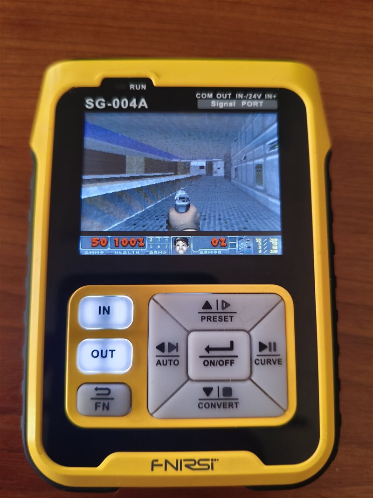
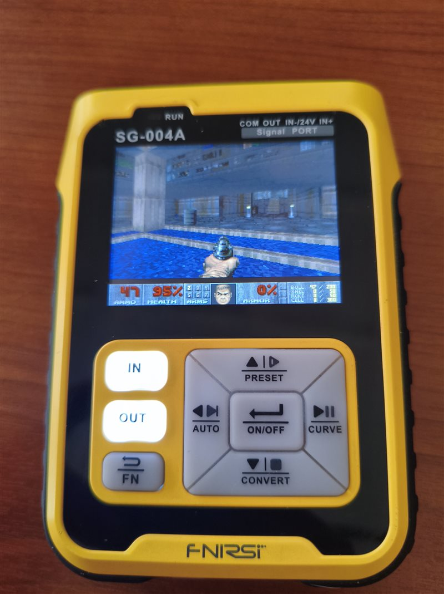

# Doom на FNIRSI SG-004A

 

Первый уровень Doom (E1M1) на генераторе сигналов FNIRSI SG-004A. Движок: [DMC100-Doom](https://github.com/ArturBieniek4/DMC100-Doom).
Графика Freedoom (оригинальную можно собрать из вашего WAD, см. [docs](docs/ORIGINAL_DOOM.ru.md)). Звука и сохранений нет.

> **На свой риск.** Проверено на одном приборе, стоковая прошивка V3.0_20230825.

**Клавиши**

| Клавиша | Уровень | Меню |
|---|---|---|
| UP / DOWN | вперёд / назад | вверх / вниз |
| LEFT / OK | поворот влево / вправо | влево / Enter |
| OUT / RIGHT | шаг влево / вправо | – / вправо |
| IN | огонь | Enter |
| FN | использовать | Esc |
| POWER | коротко: меню, 2 с: выключить | |

**Установка.** Файлы из [Releases](../../releases) (или [собранные из исходников](docs/BUILD.ru.md)).

*Часть 1. Загрузчик данных*
1. На выключенном приборе вставьте data-провод (USB к ПК).
2. Один раз нажмите кнопку питания: в ПК появится USB-диск `BOOTLOADER`.
3. Скопируйте на него `SG004_NORLOAD.bin`.
4. Прибор перезапустится: на экране `JEDEC EF4014` и `waiting for doom.uf2`, в ПК появится ещё один диск.

*Часть 2. Данные игры*

5. Скопируйте на этот диск `doom.uf2` (около минуты).
6. Дождитесь `DONE: verified` и `History unchanged`, не отключайте провод во время записи.
7. Извлеките диск в Windows и выключите прибор.

*Часть 3. Игра*

8. На выключенном приборе снова вставьте data-провод и один раз нажмите кнопку питания.
9. Скопируйте на диск `BOOTLOADER` файл `SG004_DOOM.bin`. Прибор запустит Doom.

**Вернуть стоковую прошивку:** скопируйте стоковый `.bin` FNIRSI на `BOOTLOADER`. Данные Doom во внешней флеш-памяти останутся
неиспользованными; чтобы стереть их, включите `SG004_NORLOAD.bin` с зажатой FN и удерживайте OK 2 с.
Что и куда пишется: [docs/INSTALL.ru.md](docs/INSTALL.ru.md). Сборка: [docs/BUILD.ru.md](docs/BUILD.ru.md).
GPL-2.0-or-later ([LICENSE](LICENSE), [NOTICE](NOTICE.md)); данных игры в репозитории нет.

---

# Doom on the FNIRSI SG-004A

 

E1M1 of Doom on the FNIRSI SG-004A signal generator. Engine: [DMC100-Doom](https://github.com/ArturBieniek4/DMC100-Doom).
Freedoom art (the original art can be built from your own WAD, see [docs](docs/ORIGINAL_DOOM.md)). No sound, no saves.

> **At your own risk.** Tested on one unit, stock firmware V3.0_20230825.

**Keys**

| Key | Level | Menu |
|---|---|---|
| UP / DOWN | forward / back | up / down |
| LEFT / OK | turn left / right | left / Enter |
| OUT / RIGHT | strafe left / right | – / right |
| IN | fire | Enter |
| FN | use | Esc |
| POWER | tap: menu, hold 2 s: off | |

**Install.** Files from [Releases](../../releases) (or [built from source](docs/BUILD.md)).

*Part 1. Data loader*
1. With the device off, plug in the data cable (USB to the PC).
2. Press the power button once: a `BOOTLOADER` USB drive appears.
3. Copy `SG004_NORLOAD.bin` to it.
4. The device restarts: the screen shows `JEDEC EF4014` and `waiting for doom.uf2`, and a second drive appears.

*Part 2. Game data*

5. Copy `doom.uf2` to that drive (about a minute).
6. Wait for `DONE: verified` and `History unchanged`; do not unplug while it writes.
7. Eject the drive in Windows and power the device off.

*Part 3. The game*

8. With the device off, plug in the data cable again and press the power button once.
9. Copy `SG004_DOOM.bin` to the `BOOTLOADER` drive. The device starts Doom.

**Back to stock:** copy FNIRSI's stock `.bin` to `BOOTLOADER`. Doom's data in the external flash stays there unused; to remove it,
power on `SG004_NORLOAD.bin` with FN held, then hold OK for 2 s.
What is written where: [docs/INSTALL.md](docs/INSTALL.md). Build: [docs/BUILD.md](docs/BUILD.md).
GPL-2.0-or-later ([LICENSE](LICENSE), [NOTICE](NOTICE.md)); no game data in this repository.
